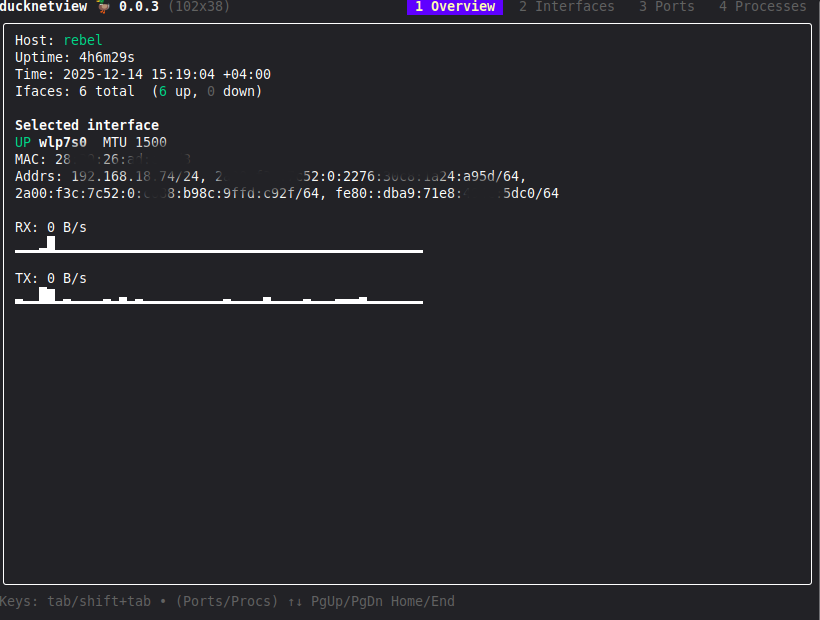
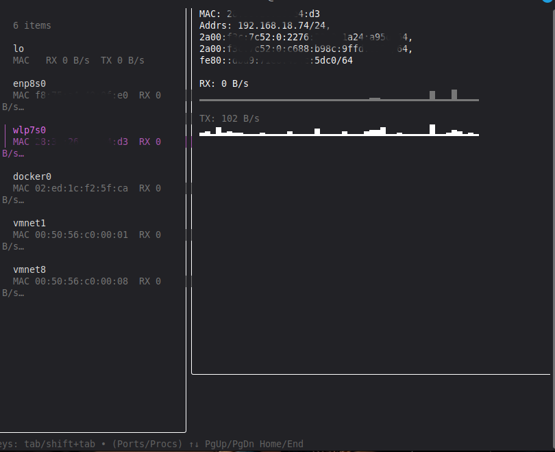
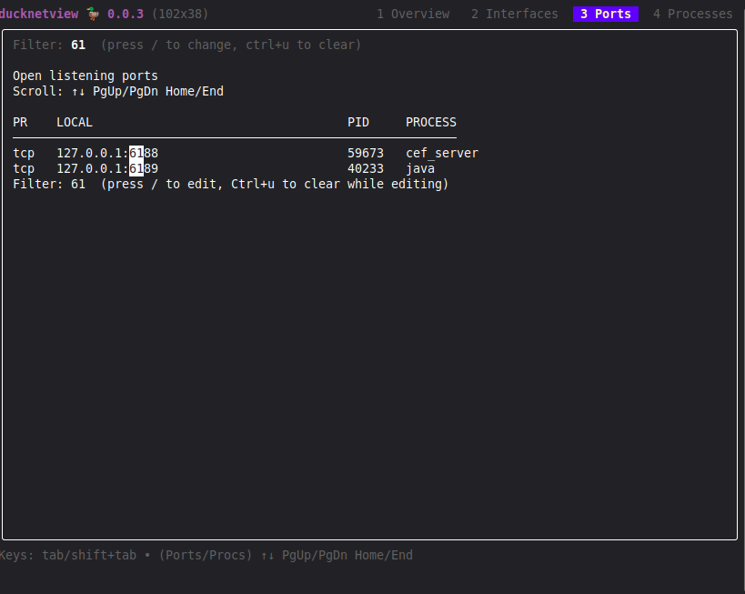
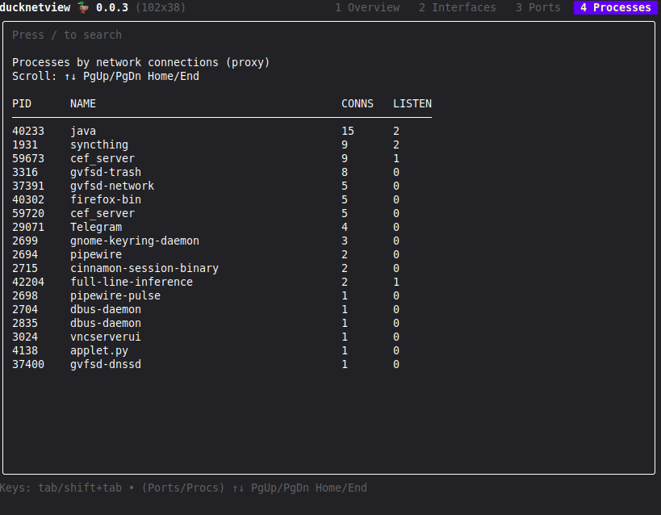

# ducknetview 🦆

Minimalistic **network monitoring TUI** written in **Go**.

Current version: **0.0.5**

Built with:
- **Bubble Tea** + **bubbles** (UI framework)
- **lipgloss** (styling)
- **tcell** (terminal backend, kept in the build for completeness)
- **gopsutil/v4** (network / process info)

The focus is a clean, usable terminal UI even on hosts with many interfaces (Docker, bridges, veth).






---

## Features

- **Overview tab**
    - Hostname, uptime, current timestamp
    - Interface count (up / down)
    - Selected interface summary with RX/TX rate and sparkline charts
    - **External IP** (fetched from `api.ipify.org`, auto-refreshed every 30 s, manual refresh with `ctrl+e`)

- **Interfaces tab**
    - Scrollable interface list (left pane)
    - Auto-updating details on selection change (no Enter required)
    - Per-interface RX/TX sparkline charts

- **Ports tab**
    - Open listening TCP / UDP ports
    - PID and process name (best-effort)
    - Scrollable list
    - Search (`/`) by port, address, protocol or process name

- **Processes tab**
    - Processes ranked by network connection count (top 80)
    - Connection count and listening-socket count per process
    - Scrollable list
    - Search (`/`) by process name or PID

- **Connections tab**
    - All active (non-listening) TCP/UDP connections
    - Local / remote address, state, PID, process
    - Optional **reverse DNS** for remote addresses (toggle with `r`)
    - Optional **grouping** view (toggle with `g`)
    - Search (`/`) by local / remote address, process, state or protocol

Data is refreshed every second; the heavier `ports / procs / conns` probes run roughly every 5 seconds.

---

## Key bindings

### Global

| Key                  | Action |
|----------------------|--------|
| `←` `→`              | Switch tabs |
| `tab` / `shift+tab`  | Cycle tabs |
| `ctrl+e`             | Refresh external IP now |
| `ctrl+c`             | Quit |

### Lists / Viewports

| Key            | Action |
|----------------|--------|
| `↑ ↓`          | Scroll |
| `PgUp / PgDn`  | Page scroll |
| `Home / End`   | Jump to top / bottom |

### Search (Ports / Processes / Connections)

| Key      | Action |
|----------|--------|
| `/`      | Start search |
| `Enter`  | Apply search filter |
| `Esc`    | Exit search |
| `Ctrl+u` | Clear query (while searching, or when search not active to clear active filter) |

### Connections tab only

| Key | Action |
|-----|--------|
| `r` | Toggle reverse DNS for remote addresses |
| `g` | Toggle grouping view |

---

## Build & run

```bash
go mod tidy
go run ./cmd/ducknetview
```

Build a binary:

```bash
go build -o ducknetview ./cmd/ducknetview
./ducknetview
```

### Debian package

Two helper scripts are included for producing `.deb` packages:

```bash
./build-deb.sh           # amd64 (default)
./build-deb.sh arm64     # cross-build for arm64
./build-deb-arm64.sh     # convenience wrapper for arm64
```

Output lands in `build/ducknetview_<version>_<arch>.deb`.

`dpkg-deb` is required. When cross-compiling, `CGO_ENABLED=0` is used.

---

## Project layout

```
cmd/ducknetview/   - main entry point
internal/probe/    - data collection (interfaces, ports, processes, connections, reverse DNS)
internal/ui/       - Bubble Tea model, views, styles, sparkline rendering
resources/         - screenshots
DEBIAN/            - control files for the .deb package
```

---

## Notes

- Process ↔ port mapping may require elevated privileges depending on OS.
- Per-process bandwidth is **not** implemented (would require eBPF / netlink accounting).
- Reverse DNS lookups have a 1.5 s timeout and are cached per session.
- External IP fetch uses a fresh HTTP transport each time (avoids stale keep-alive sockets after VPN / route changes).
- Primarily tested on Linux.

---

## License

MIT
